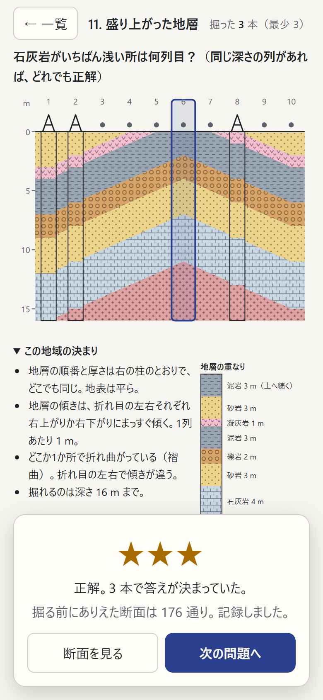
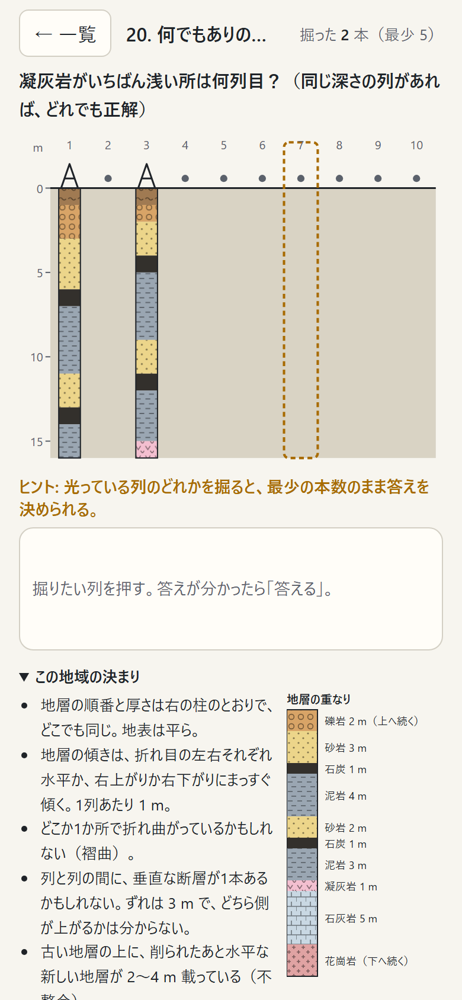
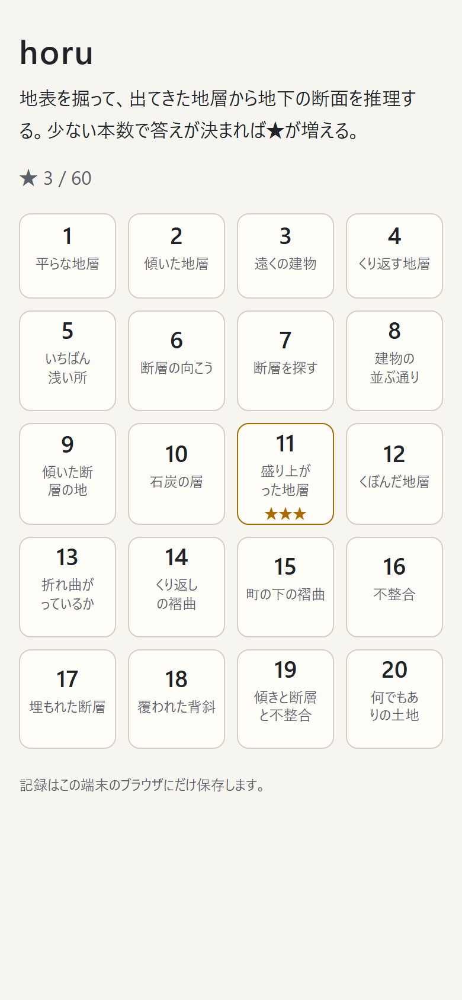

# horu

地表を掘って、出てきた地層（柱状図）から地下の断面を推理するゲーム。
「建物の下で凝灰岩は深さ何 m から出るか」「断層はどの列の間か」「石灰岩がいちばん浅いのは何列目か」に、なるべく少ない本数で答える。
傾いた地層・断層・褶曲・不整合を扱う全20問。

**アプリ:** https://tame0522works-art.github.io/horu/ （スマホ・PC のブラウザで、開くだけで遊べる）



外部のデータは使わず、判定はすべてブラウザの中で行う。地域も地層も架空のもの。
公開版は Content Security Policy で通信（fetch など）をすべて禁じていて、記録はその端末のブラウザにだけ残る。

## 遊び方

| 途中とヒント | 一覧 |
|---|---|
|  |  |

- 列を押すと「N 列目を掘る」ボタンが出る。掘ると、その列の深さ 0 m から掘れる深さまでの柱状図が出る。掘り直しはできない
- 建物のある列は掘れない。深さを聞かれる地点は、たいてい建物の下にある
- 「この地域の決まり」に、地層の順番と厚さ（どこでも同じ）、傾き・断層・褶曲・不整合がありうるかが書いてある。これと柱状図から、ありうる断面を絞る
- 分かったと思ったら「答える」。いちばん浅い列を聞く問題は、断面の列を押しても選べる
- 選んだ答えが、掘った結果から **確かだと言えれば** 正解で、本数で ★ が付く。「どう掘っても答えが決まる最少の本数」以内なら ★3、1本多いと ★2
- まだ確かでないのに答えて当たったときは、運なので ★1。同じ深さの列が並ぶ問題で、確かな列とまだ分からない列があるときも、分からない方を選んで当たれば ★1。はずれたら断面を見せて、最初からやり直す
- 答えたあとの案内を閉じて断面を見ているあいだも、下のボタンから次の問題へ進める（はずれなら「もう一度」）
- **ヒント**: 掘ると最少の本数のまま答えを決められる列を、金色の点線で光らせる。もう決まっていれば「もう答えは決まっている」と出る

## 作りの要点

### 断面を「列ごとに削られた厚さ」で表す

[`src/engine/section.ts`](src/engine/section.ts)。地層の重なり（上から順番と厚さが決まっている）はどの列でも同じとし、
列 x の地表から深さ z にあるのは、重なりの上から z + h(x) メートルの位置の岩とする。h(x) はその列で削られた厚さ。

- 傾き: h が列ごとに一定の量（1列あたり 0・±1・±2 m）で増える
- 褶曲: 折れ目の列の左右で傾きが変わる
- 断層: 列と列の間で、右側の h が一定の量だけずれる（断層は垂直とする）
- 不整合: 深さ 0〜U m に水平な新しい地層が載り、その下に古い地層が h(x) で削られて続く。断層は不整合面より下だけを切る

傾きは最初 ½ m も入れていたが、切り捨てで境目が階段状に揺れ、「まっすぐ傾く」に見えなかったので整数だけにした。

### ありうる断面を全部数えて「決まった」を判定する

[`src/engine/space.ts`](src/engine/space.ts)。問題ごとの「この地域の決まり」（`family`）から、ありうる断面をすべて作る（9〜約2万通り）。
同じ断面になる組み合わせは1つにまとめ、受け入れる答えはその共通部分にする（見分けようがないので、全員が認める答えだけが確か）。
掘った列の柱状図が本当の断面と同じ断面だけを残し、残った断面すべてが受け入れる答えがあれば「答えが決まった」とする。
答えは選択肢の番号のビット集合で持つので、判定は AND を取るだけで済む。

### どう掘っても決まる最少の本数

[`src/engine/solve.ts`](src/engine/solve.ts)。★3 の基準は、結果を見ながら次に掘る列を変えてよいとしたときの、最悪の場合の本数（ミニマックス）。
「候補の集合から d 本以内で決められるか」を、どの列を掘っても候補が柱状図ごとに分かれる、という分かれ方のすべてについて再帰的に調べ、d を 0 から増やす。
候補の集合と残りの本数で結果を覚え、最悪の場合に残る候補が少ない列から試す。20問目（約2万通り）でも 0.2 秒ほど。

建物のすぐ隣に断層がありうると、その断面ではどう掘っても答えが決まらない。最初はそのせいで最少本数が求まらなかった。
そこで「答えが決まるか、どの列を掘っても候補が分かれなくなる」までの本数に定義し直した。
本当の断面は掘れる列を全部掘れば答えが決まることを `check:puzzles` で確かめているので、遊ぶ人にとっては「答えが決まる最少本数」と同じになる。

ヒントは、掘ったあと残り（最少本数 − 1）本で決められる列。運よく当てた場合の下限（本当の断面で答えが決まる最少の列の組）も `tools/show.ts` で出せる。

## 確かめ方

| コマンド | 確かめること |
|---|---|
| `npm run check:engine` | 手で答えの分かる例（重なりの境目・切り捨て・褶曲・断層・削られ切った層・不整合の厚さ・問いの答え・同じ深さの列が並ぶときに確かでない方の列を「確か」にしない判定）、覚えも並べ替えもしない素朴な実装と無作為な50の地域で最少本数が一致すること、ヒントどおりに掘ると最少本数以内で本当の答えに決まること |
| `npm run check:puzzles` | 20問すべてで、掘らずには決まらない、掘れる列を全部掘れば本当の答えに決まる、持たせた最少本数が探索の結果と同じ、どの列からヒントをたどっても最少本数以内で決まる、深さを聞く列が掘れない列になっている |
| `npm run e2e` | 公開と同じビルドを画面なしの Chrome で開き、本物のマウス・タッチ・キーボードで操作する（11件）。スマホの指で2問目を解いて記録が残り、断面を見たあと次の問題へ進める、建物の列は掘れない、運で当てると ★1、はずれ、スマホの指で20問目をヒントだけで ★3、列を押して答える、不整合の表示と岩の模様の id が重ならないこと、キーボード操作、保存できないブラウザでも遊べる、CSP で通信が止まる |

## 扱っていないこと

- 奥行き。2次元の断面だけで、地質図（上から見た図）や走向・傾斜は扱わない
- 地表の起伏。地表は平らとする
- 傾いた断層・逆断層の重なり・複数の断層や褶曲。断層は垂直に1本、褶曲の折れ目は1か所まで
- 層の厚さの変化（尖滅）。厚さはどこでも同じとする
- 実在の地域やボーリングデータ

## 開発

```bash
npm install
npm run dev            # http://localhost:5215/
npm run check          # check:engine・check:puzzles
npm run e2e            # 画面操作のテスト
npm run show -- arch   # 問題の断面を文字で描き、候補の数・最少本数・ヒントを出す
npm run fill-best      # 問題の best を最少本数で書き直す
npm run build && npm run preview   # 公開版を http://localhost:5216/ で確かめる
npm run screenshots    # 公開版から docs/images/ の画像を撮る
```
